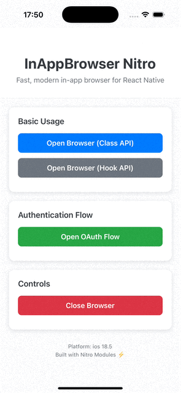

# react-native-inappbrowser-nitro

Native browser presentation through [Nitro Modules](https://nitro.margelo.com/): Safari on iOS, Custom Tabs on Android, and a separate authentication API.

[](https://www.npmjs.com/package/react-native-inappbrowser-nitro)
[](./LICENSE)

[Install](#installation) · [Expo](#expo-development-and-production-builds) · [Usage](#usage) · [API](#api) · [Options](#options)



> [!IMPORTANT]
> Use a native iOS or Android build. Expo Go, web and server rendering cannot run this native module. The example targets React Native 0.88.1 and Nitro 0.37.2; those dependency versions alone do not establish compatibility with every host app or Expo SDK.

## Installation

```sh
yarn add react-native-inappbrowser-nitro react-native-nitro-modules
```

Install pods for iOS, using the Ruby setup of your app:

```sh
cd ios
bundle exec pod install
```

React Native autolinking handles native registration. Android release keep rules ship with the library. Rebuild your app after installing or upgrading native dependencies. The Android library requires API 24 or later; iOS deployment requirements also depend on the React Native version in your app.

### Expo development and production builds

Install versions compatible with your Expo SDK:

```sh
npx expo install react-native-inappbrowser-nitro react-native-nitro-modules expo-dev-client
npx expo install --check
```

Tested with Expo 58.0.23, React Native 0.88.1 and Nitro 0.37.2 in an app installed from the packed library. Android debug and R8 release builds passed. Expo iOS generation and autolinking passed; Expo iOS compilation has not been checked.

Expo SDKs select their own React Native versions. Resolve version conflicts before compiling; upgrading this library's example does not upgrade an Expo project.

For a custom OAuth callback, configure a scheme owned by your app:

```json
{
  "expo": {
    "name": "Browser example",
    "slug": "browser-example",
    "scheme": "myapp",
    "ios": { "bundleIdentifier": "com.example.browser" },
    "android": { "package": "com.example.browser" }
  }
}
```

The callback for the examples below is `myapp://oauth/callback`. Register the same URI with your identity provider. Expo generates native scheme registration from this configuration. No library-specific config plugin is required.

Build locally:

```sh
npx expo run:ios
npx expo run:android
npx expo start --dev-client
```

For EAS, configure your project and add development and production profiles:

```sh
npx eas-cli@latest login
npx eas-cli@latest build:configure
```

```json
{
  "build": {
    "development": {
      "developmentClient": true,
      "distribution": "internal"
    },
    "production": {}
  }
}
```

```sh
npx eas-cli@latest build --profile development --platform android
npx eas-cli@latest build --profile production --platform all
```

A development build includes the native module and connects to Metro. A production build bundles the app for distribution. iOS device distribution requires Apple signing setup; use a separate profile with `ios.simulator: true` for simulator builds. Store submission is a separate step. See [Expo development builds](https://docs.expo.dev/develop/development-builds/introduction/) and [EAS setup](https://docs.expo.dev/build/setup/).

> [!NOTE]
> Native dependency, URL scheme, associated-domain and manifest changes require a new binary. EAS Update cannot add them. `expo prebuild --clean` regenerates native projects and removes manual native edits; keep app configuration in Expo config or a host-owned config plugin.

### Android callback setup

Auth Tab handles callbacks through an Activity Result when the selected browser supports it. The Custom Tabs fallback receives callbacks through your host activity. Keep the activity in `singleTask` mode and register your app scheme. Expo normally generates this setup; inspect the merged manifest after prebuild.

For a bare app, the relevant parts of `AndroidManifest.xml` are:

```xml
<activity
  android:name=".MainActivity"
  android:exported="true"
  android:launchMode="singleTask">
  <intent-filter>
    <action android:name="android.intent.action.VIEW" />
    <category android:name="android.intent.category.DEFAULT" />
    <category android:name="android.intent.category.BROWSABLE" />
    <data android:scheme="myapp" android:host="oauth" android:path="/callback" />
  </intent-filter>
</activity>
```

If you override `onNewIntent`, forward it to React Native through the superclass. HTTPS callbacks additionally require verified Android App Links; configure the host app and domain association. iOS Universal Links require associated domains, but verified HTTPS auth callback support is still deferred in this library's iOS adapter. Use a registered custom scheme there.

## Usage

```ts
import { open } from 'react-native-inappbrowser-nitro'

const result = await open('https://example.com', {
  preferredBarTintColor: { base: '#FFFFFF', dark: '#111111' },
  toolbarColor: { base: '#FFFFFF', dark: '#111111' },
})
```

`open` resolves when presentation or launch succeeds. It does not wait for dismissal or report subsequent navigation. A successful result normally contains the requested URL.

### React hook

```tsx
import { Pressable, Text } from 'react-native'
import { useInAppBrowser } from 'react-native-inappbrowser-nitro/hooks'

export function BrowserButton() {
  const { open, isLoading, error } = useInAppBrowser()

  return (
    <>
      <Pressable
        disabled={isLoading}
        onPress={() => {
          void open('https://example.com').catch(() => {})
        }}
      >
        <Text>{isLoading ? 'Opening…' : 'Open website'}</Text>
      </Pressable>
      {error && <Text accessibilityRole="alert">{error.message}</Text>}
    </>
  )
}
```

The hook exposes stable callbacks, loading state and the last thrown error. Handle rejected promises even when displaying `error`. Avoid overlapping calls: loading uses one Boolean and may clear before another call finishes.

### Authentication

```ts
import { openAuth } from 'react-native-inappbrowser-nitro'

const redirectUrl = 'myapp://oauth/callback'
// Build authorizationUrl with your OAuth client, including PKCE and state.
const result = await openAuth(authorizationUrl, redirectUrl)

if (result.type === 'success' && result.url) {
  // Give the callback to your OAuth client to validate state and exchange the code.
} else if (result.type === 'cancel') {
  // The user or app canceled the session.
} else {
  // Presentation, provider or callback verification failed; inspect result.message.
}
```

Android uses Auth Tab when available and a Custom Tabs fallback otherwise. It checks the returned scheme, host, explicit port and encoded path against `redirectUrl`. Configure the redirect without credentials, query parameters or a fragment. The returned callback may contain a query or fragment carrying the authorization response. Custom schemes must be hierarchical, such as `myapp://oauth/callback`.

`ephemeralWebSession: true` requests an ephemeral authentication session. Android refuses the request when the selected provider lacks that capability. Ordinary `open` does not offer cookie isolation. Browser and OS policies determine cookie behavior; do not assume Safari presentation shares the Safari app's complete cookie store.

> [!WARNING]
> The iOS auth adapter currently matches only the callback scheme and does not prevent overlapping sessions or handle failed starts deterministically. Keep one session active, validate the full callback in your OAuth client and test cancellation on your supported devices.

Your OAuth client owns PKCE S256, unpredictable state, nonce validation where applicable, token exchange and secure token storage. A matching redirect URI alone does not authenticate a response.

## API

Functions return promises after argument validation; invalid arguments can throw synchronously. Import them from the package root; import the hook from `/hooks`. Public types and enum-like constants are also available from `/types`.

| Function                               | Behavior                                                                                                                                       |
| -------------------------------------- | ---------------------------------------------------------------------------------------------------------------------------------------------- |
| `isAvailable()`                        | iOS returns `true`; Android checks for a Custom Tabs provider or an app that handles HTTPS. This does not prove Auth Tab or ephemeral support. |
| `open(url, options?)`                  | Launch/present an ordinary browser and return immediately after launch.                                                                        |
| `openAuth(url, redirectUrl, options?)` | Wait for an authentication callback, cancellation or failure.                                                                                  |
| `close()`                              | Dismiss ordinary Safari presentation on iOS. Currently a no-op on Android.                                                                     |
| `closeAuth()`                          | Request cancellation of the current auth session. iOS settlement limitations remain as described above.                                        |
| `useInAppBrowser()`                    | Return these methods plus `isLoading` and `error`.                                                                                             |

```ts
interface InAppBrowserResult {
  type: 'success' | 'cancel' | 'dismiss'
  url?: string
  message?: string
}
```

`InAppBrowserAuthResult` has the same shape. Native presentation failures usually return `dismiss`; JS validation and module initialization can throw before returning a promise. Use `try/catch` as well as checking `result.type`.

Initial browser URLs must use HTTP(S), include a host and contain no embedded credentials, whitespace or control characters. Prefer HTTPS for authentication. Custom schemes are for callbacks, not the initial page.

## Options

Native browser support varies. Ordinary Safari options generally do not apply to `ASWebAuthenticationSession`. Android Auth Tab also has a smaller option surface than ordinary Custom Tabs; presentation hints are not guaranteed for auth.

<details>
<summary>iOS, Android and dynamic color reference</summary>

### iOS

| Option                          | Type                                           | Default           | Notes                                                                                                         |
| ------------------------------- | ---------------------------------------------- | ----------------- | ------------------------------------------------------------------------------------------------------------- |
| `dismissButtonStyle`            | `'done' \| 'close' \| 'cancel'`                | `'done'`          | Toolbar dismiss button label.                                                                                 |
| `preferredBarTintColor`         | `DynamicColor`                                 | system            | Safari toolbar background hint. iOS 26 Liquid Glass may ignore it.                                            |
| `preferredControlTintColor`     | `DynamicColor`                                 | system            | Safari control tint hint. iOS 26 may adapt it for contrast.                                                   |
| `preferredStatusBarStyle`       | `'default' \| 'lightContent' \| 'darkContent'` | system            | Status bar appearance while presented.                                                                        |
| `readerMode`                    | `boolean`                                      | `false`           | iOS only. Ask Safari to enter Reader Mode if the page supports it; Android Custom Tabs ignore this option.    |
| `animated`                      | `boolean`                                      | `true`            | Animate present/dismiss.                                                                                      |
| `modalPresentationStyle`        | `ModalPresentationStyle`                       | `'automatic'`     | UIKit modal style.                                                                                            |
| `modalTransitionStyle`          | `ModalTransitionStyle`                         | `'coverVertical'` | UIKit transition. Use `'partialCurl'` only with `'fullScreen'`.                                               |
| `modalEnabled`                  | `boolean`                                      | `true`            | Present modally instead of pushing onto a navigation stack.                                                   |
| `enableBarCollapsing`           | `boolean`                                      | `false`           | Collapse toolbar on scroll.                                                                                   |
| `ephemeralWebSession`           | `boolean`                                      | `false`           | `openAuth` only: request an ephemeral session. Android requires provider capability and fails if unavailable. |
| `enableEdgeDismiss`             | `boolean`                                      | `true`            | Control ordinary Safari presentation dismissal; does not control authentication UI.                           |
| `overrideUserInterfaceStyle`    | `'unspecified' \| 'light' \| 'dark'`           | `'unspecified'`   | Force light/dark while presented.                                                                             |
| `formSheetPreferredContentSize` | `{ width, height }`                            | UIKit             | Preferred form-sheet size. UIKit may adapt or ignore it on iPhone.                                            |

### Android

| Option                      | Type                            | Default         | Notes                                                                                               |
| --------------------------- | ------------------------------- | --------------- | --------------------------------------------------------------------------------------------------- |
| `showTitle`                 | `boolean`                       | `true`          | Show page title under the URL bar.                                                                  |
| `toolbarColor`              | `DynamicColor`                  | browser default | Top toolbar background.                                                                             |
| `secondaryToolbarColor`     | `DynamicColor`                  | browser default | Bottom toolbar background.                                                                          |
| `navigationBarColor`        | `DynamicColor`                  | system          | API 27+.                                                                                            |
| `navigationBarDividerColor` | `DynamicColor`                  | system          | API 28+.                                                                                            |
| `enableUrlBarHiding`        | `boolean`                       | `false`         | Hide URL bar on scroll.                                                                             |
| `enableDefaultShare`        | `boolean`                       | browser default | `false` disables sharing; `true` keeps browser defaults. Use `shareState: 'on'` to request sharing. |
| `shareState`                | `'default' \| 'on' \| 'off'`    | `'default'`     | Override share menu visibility.                                                                     |
| `colorScheme`               | `'system' \| 'light' \| 'dark'` | `'system'`      | Custom Tab theme hint.                                                                              |
| `headers`                   | `Record<string, string>`        | `{}`            | HTTP headers on initial request.                                                                    |
| `forceCloseOnRedirection`   | `boolean`                       | `false`         | Legacy field; auth sessions own callback cleanup. Ordinary `open` does not intercept redirects.     |
| `hasBackButton`             | `boolean`                       | `false`         | Show back arrow instead of X.                                                                       |
| `browserPackage`            | `string`                        | auto            | Pin to a specific browser, e.g. `com.android.chrome`.                                               |
| `showInRecents`             | `boolean`                       | `true`          | Keep the tab in Android Recents after closing.                                                      |
| `includeReferrer`           | `boolean`                       | `false`         | Send the host app package as `Referrer`.                                                            |
| `instantAppsEnabled`        | `boolean`                       | `true`          | Allow Instant Apps to handle the URL.                                                               |
| `enablePullToRefresh`       | `boolean`                       | unset           | Known issue: currently enables URL-bar hiding. Do not rely on it for refresh control.               |
| `enablePartialCustomTab`    | `boolean`                       | `false`         | Request a bottom sheet on API 30+; browser support determines behavior.                             |
| `animations`                | `BrowserAnimations`             | system          | Custom enter/exit animation resource names.                                                         |

### Dynamic colors

Color options accept a `DynamicColor` object:

```ts
interface DynamicColor {
  base?: string // fallback
  light?: string // light mode
  dark?: string // dark mode
  highContrast?: string // increased contrast, where supported
}
```

Use `#RRGGBB` or `#AARRGGBB`. Native fallback behavior differs by platform; provide `base` for a predictable fallback. Android does not detect high-contrast mode. Safari tint hints are deprecated on current iOS and may be ignored.

</details>

## Known limits

- Ordinary Android `open` can fall back to a system browser. Browser presentation options do not apply to that fallback. An unavailable explicitly selected provider returns `dismiss`.
- iOS interactive dismissal can leave retained presentation state; verify dismiss/reopen behavior for the presentation styles your app uses.
- Custom scheme registration is not exclusive ownership. Use verified HTTPS redirects where supported and always validate OAuth state.
- Physical devices, foldable layouts and EAS cloud builds still need testing.

## Contributing

```sh
yarn install
yarn codegen
yarn typecheck
yarn lint
yarn test
```

Follow the [native example instructions](https://github.com/mCodex/react-native-inappbrowser-nitro/blob/main/example/README.md) for iOS/Android builds, provider configuration and the local Android auth smoke check. Include the OS version, browser/provider, React Native and Nitro versions when reporting a native issue.

[MIT](./LICENSE) © [Mateus Andrade](https://github.com/mCodex)
